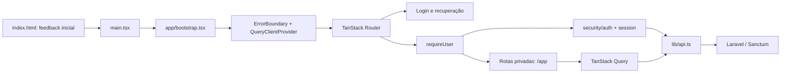

# Arquitetura e mapa do código

## Visão geral

A SPA é independente do Laravel. O navegador envia cookies ao backend, e o servidor valida a sessão e toda autorização. SolidJS controla a interface; TanStack Router controla rotas, Query controla dados remotos e Form controla formulários. Zod valida contratos e entradas na interface.

## Diretórios

| Local                   | Responsabilidade                                                                                         |
| ----------------------- | -------------------------------------------------------------------------------------------------------- |
| `index.html`            | HTML inicial e loading visível antes do JavaScript; carrega o Tailwind compilado                         |
| `src/main.tsx`          | Importa o bootstrap, remove o loading quando há conteúdo real e mostra recuperação se o bootstrap falhar |
| `src/app/bootstrap.tsx` | Monta o Solid e inicializa navegação, erros e monitoramento sem bloquear a interface                     |
| `src/app/config.ts`     | Valida variáveis públicas com Zod; exporta configuração normalizada                                      |
| `src/app/providers.tsx` | ErrorBoundary global e QueryClientProvider                                                               |
| `src/app/router.tsx`    | Cria o router, configura pending e observa eventos de sessão/visibilidade                                |
| `src/routes`            | Adaptadores de página: rota, metadados, guards e componente principal                                    |
| `src/features/auth`     | UI, schemas, tipos e operações de autenticação                                                           |
| `src/security`          | Sessão, guards, permissões e redirecionamento seguro                                                     |
| `src/lib`               | Cliente HTTP, erros tipados, QueryClient e SEO                                                           |
| `src/monitoring`        | Relato de erros, logs, sanitização, Sentry e analytics                                                   |
| `src/components`        | Fallbacks compartilhados e consentimento opcional                                                        |
| `src/styles/index.css`  | Somente import do Tailwind 4 e tokens `@theme`; sem CSS manual de componentes                            |
| `build/seo-assets.ts`   | Gera health.json, robots.txt e sitemap.xml                                                               |
| `scripts`               | Validações de bundle, saúde, API e envio de sourcemaps                                                   |
| `tests`                 | Testes unitários, de integração e navegador                                                              |
| `deployment`            | Exemplos Nginx e headers para hospedagem da SPA                                                          |

`src/routeTree.gen.ts` é gerado pelo plugin do Router. Não editar manualmente. `dist`, `.playwright-build`, `.tanstack`, `node_modules` e resultados de teste também não são fontes da aplicação.

## Rotas atuais

| Rota                       | Comportamento                                          |
| -------------------------- | ------------------------------------------------------ |
| `/`                        | Redireciona a `/app`; o guard decide se precisa entrar |
| `/login`                   | Login com e-mail/senha e MFA opcional                  |
| `/forgot-password`         | Solicita recuperação                                   |
| `/reset-password`          | Recebe token/e-mail na query e envia nova senha        |
| `/app`                     | Página privada mínima, sem menu ou dashboard           |
| `/403`, `/404`             | Fallbacks com metadados noindex                        |
| Qualquer rota desconhecida | Exibe página não encontrada                            |

`_authenticated.tsx` é um grupo sem segmento na URL. Ele valida a sessão, representa indisponibilidade e mantém a tela bloqueada durante logout incompleto. `__root.tsx` contém apenas metadados, main, outlet, estado de rede e consentimento opcional.

## Dependências e limites

Controllers e regras de negócio pertencem ao backend. Componentes de rota devem ser pequenos; interfaces específicas ficam em `features/<domínio>`. Reutilize componentes quando houver necessidade concreta, sem introduzir camadas de abstração para cada arquivo.

O cache de dados privados deve ser marcado com `meta.private` e ter chave vinculada à identidade. Não persista dados sensíveis no navegador. As estruturas de sessão suportam permissões/workspace recebidos do backend, mas não implementam multi-tenancy no servidor.
