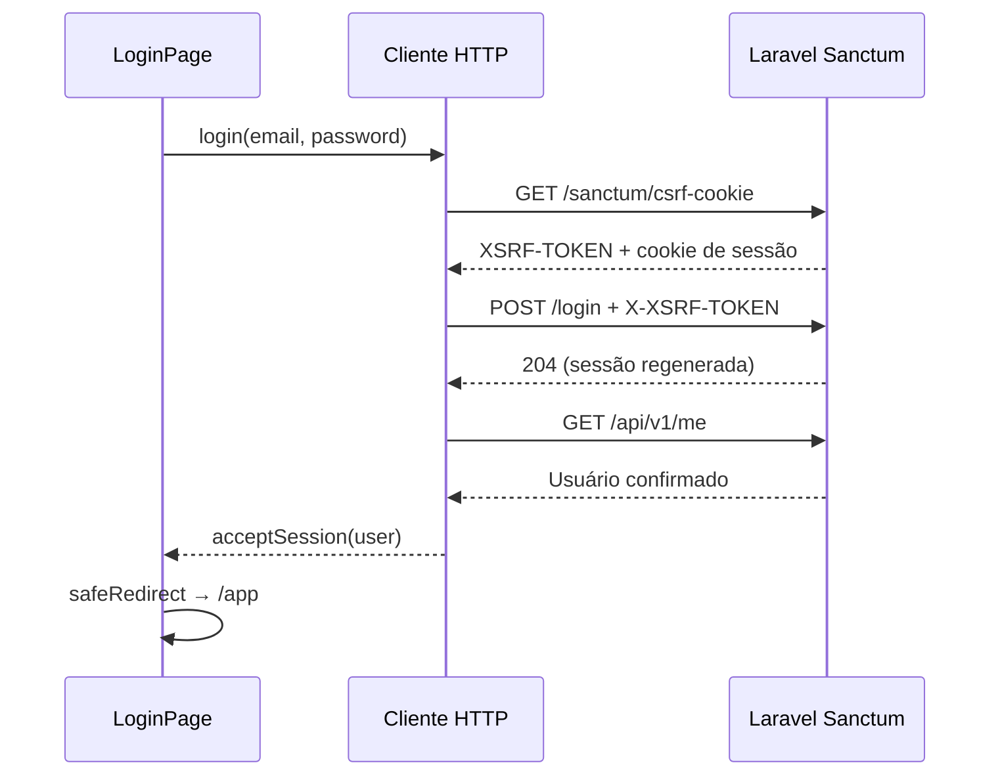

# Autenticação, sessão e API

## Fluxo de login



`LoginPage` usa TanStack Form e Zod. Os campos são limpos/tratados no fluxo de erro e a senha não é armazenada em localStorage. O botão mostrar senha altera só a apresentação do campo. Login bem-sucedido sempre consulta `/me` antes de conceder acesso visual.

## Arquivos principais

| Arquivo                                      | Papel                                                          |
| -------------------------------------------- | -------------------------------------------------------------- |
| `features/auth/components/login-page.tsx`    | Formulário, feedback, mostrar senha e MFA                      |
| `features/auth/components/password-page.tsx` | Recuperação/redefinição e mensagens                            |
| `features/auth/components/auth-frame.tsx`    | Layout simples ou split, estilos compartilhados e entrada GSAP |
| `features/auth/components/session-page.tsx`  | Confirmação visual da sessão, usuário e animação de entrada    |
| `features/auth/components/logout-button.tsx` | Logout, estado ocupado e nova tentativa após erro              |
| `features/auth/schemas/auth.schema.ts`       | Contratos de credenciais, MFA, usuário e sessão                |
| `security/auth.ts`                           | getCurrentUser, login, logout e completeMfa                    |
| `security/session.ts`                        | Signals da sessão, revisão, identidade e limpeza de cache      |
| `security/guards.ts`                         | requireUser e requirePermission                                |
| `security/safe-redirect.ts`                  | Destinos privados permitidos após login                        |

`features/auth/api/mutations.ts` e `features/auth/stores/session.ts` expõem compatibilidade com os módulos centrais; a lógica de segurança permanece em `security`.

## Estados de sessão

| Estado          | Significado                                                     |
| --------------- | --------------------------------------------------------------- |
| `unknown`       | Ainda não foi consultada                                        |
| `checking`      | Primeira validação em andamento                                 |
| `authenticated` | Backend confirmou o usuário                                     |
| `anonymous`     | Sem sessão válida                                               |
| `unavailable`   | Falha de rede/servidor; não equivale a sessão ausente           |
| `locked`        | Saída iniciada; conteúdo privado fica bloqueado até a conclusão |

Revalidações em segundo plano preservam a interface já validada enquanto a resposta está pendente. Um 401 remove o usuário e o cache; uma falha coloca a sessão como indisponível. Alterações de identidade, workspace ou permissões invalidam consultas privadas. A revisão impede que respostas antigas restaurem uma sessão encerrada.

O router revalida ao voltar à aba e a cada 60 segundos quando existe usuário e a página está visível. Não adicione polls de sessão nos componentes.

## Cliente HTTP

`api<T>(path, options)` em `src/lib/api.ts` recebe caminhos relativos à origem configurada. O genérico TypeScript não valida JSON em runtime: use Zod ao consumir contratos externos.

```ts
import { api } from "@/lib/api";
import { sessionSchema } from "@/features/auth/schemas/auth.schema";

const response = await api<unknown>("/me", { signal });
const user = sessionSchema.parse(response);
```

`signal` no exemplo é o AbortSignal da consulta/chamada que o invoca. Para autenticação, reutilize `getCurrentUser()`; não copie a gestão de sessão.

| Opção                  | Uso                                                                                          |
| ---------------------- | -------------------------------------------------------------------------------------------- |
| `method`               | GET por padrão; POST/PUT/PATCH/DELETE para escrita                                           |
| `body`                 | Objeto serializado como JSON                                                                 |
| `signal`               | Cancelamento do chamador                                                                     |
| `scope: "auth"`        | Usa a origem de autenticação, sem `/api/v1`                                                  |
| `authenticated: false` | Erro da chamada não dispara eventos globais de sessão                                        |
| `timeoutMs`            | Sobrescreve timeout para a chamada                                                           |
| `csrf: false`          | Exceção explícita para chamadas que não exigem CSRF; não usar em operações normais de sessão |

O cliente inclui cookies, Accept e identificador da requisição. Antes de escritas, prepara CSRF e envia X-XSRF-TOKEN. Bloqueia URLs absolutas e caminhos fora da base. GETs sem signal podem ser compartilhados; consultas canceláveis são deduplicadas pelo Query.

## Erros

`ApiError` distingue HTTP, timeout, offline, network, cancelled e resposta inválida. 401/403 em chamadas privadas emitem eventos centrais; 419 indica CSRF/sessão de segurança; 422 fornece erros por campo; 429 indica limite. Não mostrar stack traces nem transformar falha em sucesso vazio.

O QueryClient tenta novamente consultas elegíveis uma vez, com critérios em `shouldRetry`; mutations não repetem automaticamente. Erros técnicos passam por sanitização antes de integrações externas.

## Cache privado

```ts
queryOptions({
  queryKey: privateQueryKey("minha-funcionalidade"),
  meta: { private: true },
  queryFn: ({ signal }) => carregarDados(signal),
});
```

As funções desse exemplo são da funcionalidade a ser criada. Monte consultas privadas somente após validação da sessão. Nunca colocar senha, token ou dados pessoais na chave.

## Recuperação, MFA e logout

`forgot-password` envia email com resposta genérica do backend. `reset-password` envia token, email, password e password_confirmation. Não repassar a query do reset a analytics/logs. A política de senha efetiva é do backend; a UI atual informa os requisitos existentes.

MFA requer `VITE_ENABLE_MFA=true` e suporte correspondente do backend. O frontend reconhece `two_factor: true`; não habilite a flag sem esse contrato.

Logout limpa dados privados imediatamente, bloqueia a sessão visual e pede invalidação no servidor. Em falha, mantém o bloqueio e oferece nova tentativa. Não simule sucesso removendo apenas o cookie local.
